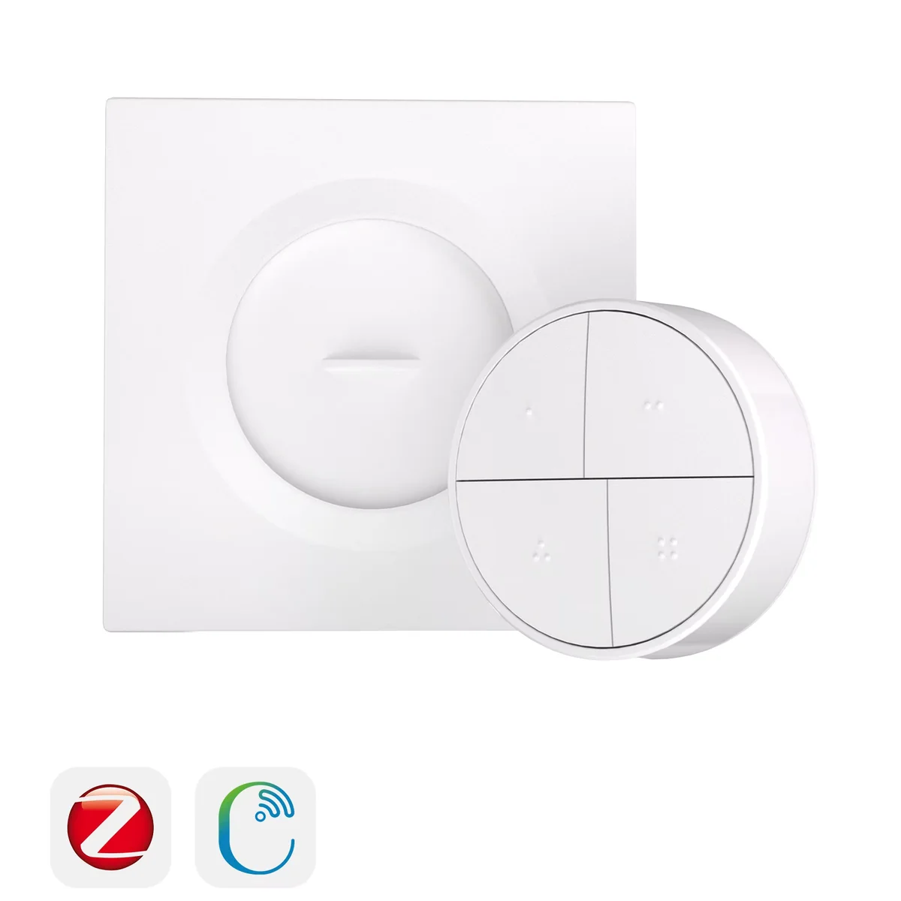

# Sonoff SNZB-01M 4-in-1 ZHA Blueprint

Updated in November 2026

<figure style="margin:0 auto 1rem;">
<figcaption style="display:block;text-align:center">Sonoff Orb 4-in-1 Zigbee Button (SNZB-01M)</figcaption>

</figure>

Home Assistant automation blueprint for the Sonoff SNZB-01M (Sonoff Orb 4-in-1 Zigbee Button) using ZHA. It provides single-, double-, triple-, and long-press actions for each of the four physical buttons (16 actions total), and requires native ZHA support for the device (no ZHA quirk).

Using this blueprint will solve the big headache of setting up the single automation for each of the 4 buttons. 

## Install

Click the button below to open the blueprint import dialogue in Home Assistant:

After importing, create an automation from the blueprint, select your ZHA
remote, and configure the actions for each button press.

## Usage 

### 1. Device

Select the Sonoff 4-In-1 Zigbee Smart Scene Button (SNZB-01M) device to create an automation.

### 2. Automation mode

Only one automation mode can be used for all buttons.

- queued (default)
- single
- restart
- parallel

More info see [Automation modes documentation](https://www.home-assistant.io/docs/automation/modes/)

### 3. Button actions

| Button | Physical position        |
| ------ | ------------------------ |
| 1      | Top left (one dot)       |
| 2      | Top right (two dots)     |
| 3      | Bottom left (three dots) |
| 4      | Bottom right (four dots) |

For each button, you can set the actions for the following triggers
- single press
- double press
- triple press
- long press

Combined, you will have 16 triggers available for your automations.

Find out more at https://www.home-assistant.io/docs/automation/action/

## Author

Claudio Gobetti

## Licence

[Apache License 2.0](LICENSE)
